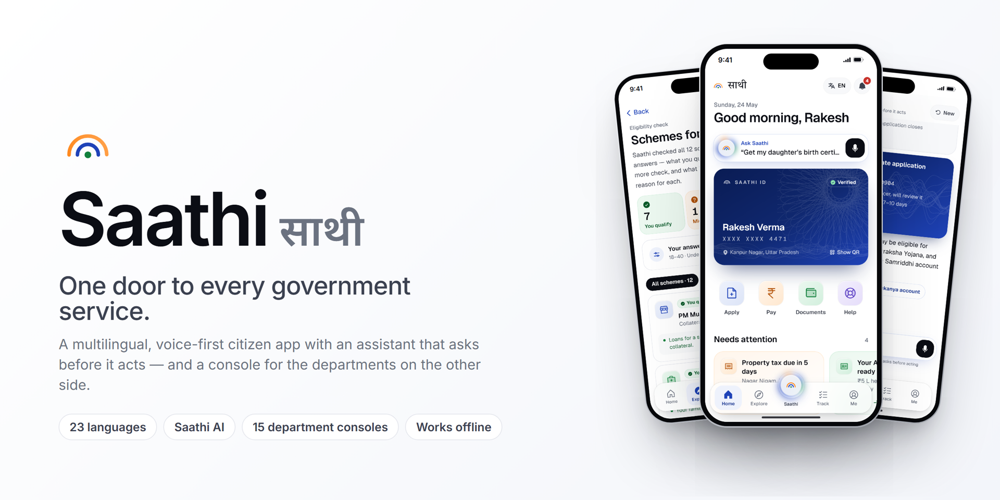
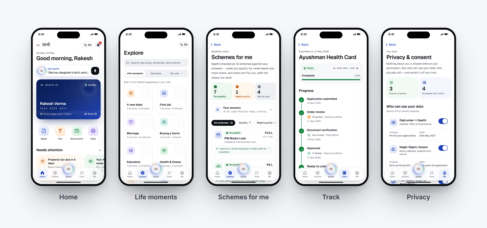
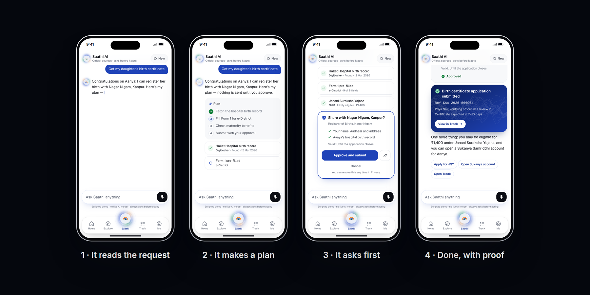
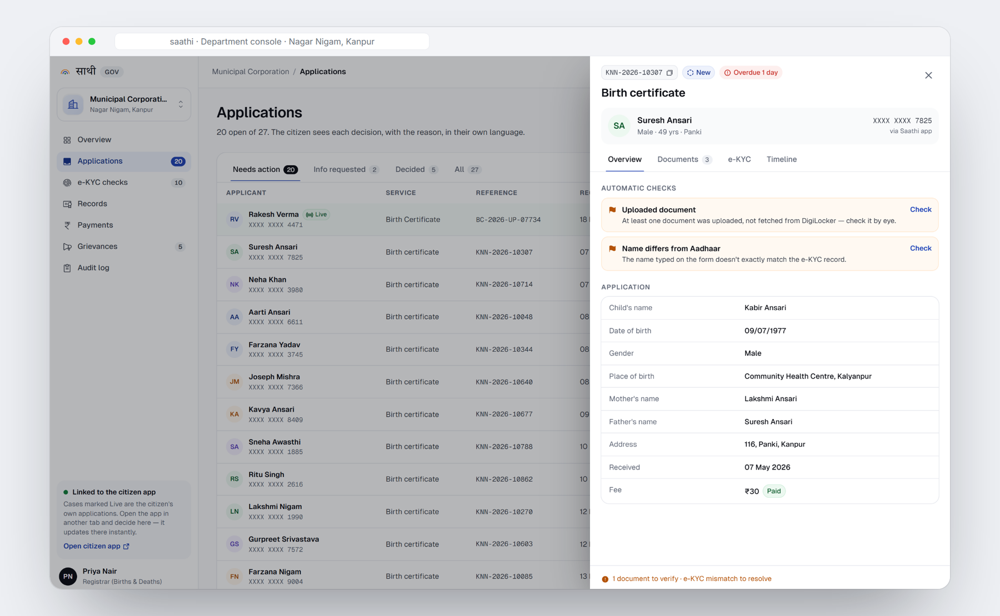
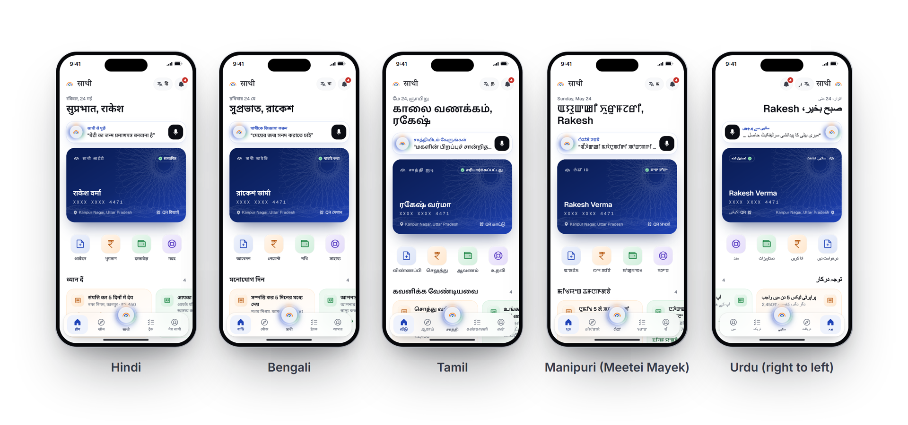
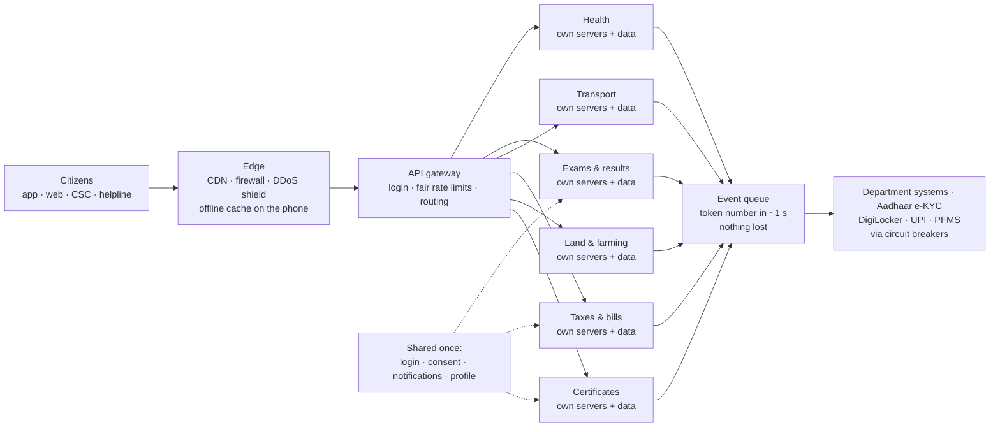
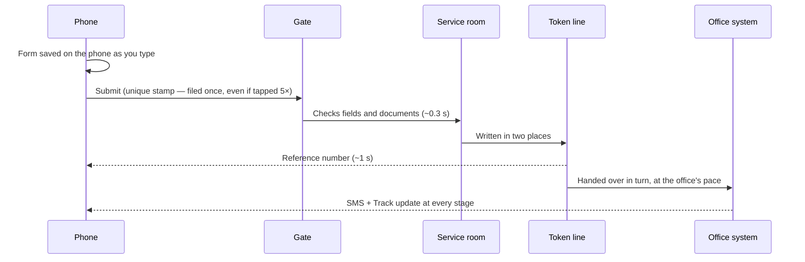

<div align="center">



# Saathi · साथी

**One door to every government service.**

A multilingual, voice-first citizen app with an assistant that asks before it acts — and a console for the departments on the other side of the counter. A design concept for **Viksit Bharat @2047**.

[Product film](presentations/Saathi-Product-Film.mp4) · [Presentations](presentations/) · [Run it locally](#8-run-it-locally) · [Architecture](#6-system--data-architecture)

</div>

> **Design concept.** Saathi is a student design project. It is **not** a Government of India website or app and is not affiliated with any government body. Every person, record, reference number and payment in the prototype is sample data; DigiLocker, UPI, Aadhaar and department systems are simulated.

---

## Contents

1. [The problem](#1-the-problem)
2. [What Saathi is](#2-what-saathi-is)
3. [Feature tour](#3-feature-tour)
4. [23 languages](#4-23-languages)
5. [Why Saathi, when these apps already exist?](#5-why-saathi-when-these-apps-already-exist)
6. [System & data architecture](#6-system--data-architecture)
7. [Tech stack](#7-tech-stack)
8. [Run it locally](#8-run-it-locally)
9. [Project structure](#9-project-structure)
10. [Quality, testing & accessibility](#10-quality-testing--accessibility)
11. [The product film](#11-the-product-film)
12. [Roadmap](#12-roadmap)
13. [Author & recognition](#13-author--recognition)

---

## 1. The problem

India has built world-class digital rails — Aadhaar, DigiLocker, UPI, and hundreds of government apps and portals. But a citizen who wants to register a birth, claim a pension or check a land record still has to know **which** app, **which** department, **which** form — often in English, with a new login each time. Many give up and pay an agent or travel to a centre.

The rails are built. **The door is missing.**

## 2. What Saathi is

Saathi is that door — one calm app, organised around **what is happening in your life** rather than around departments.

- **Starts from your life.** “We had a baby” opens the birth certificate, vaccination and maternity benefits together.
- **Saathi AI does the work — and asks first.** It reads your request, makes a plan, fills forms from DigiLocker, and submits only after you approve a card that says exactly what is shared, with whom and for how long.
- **Speaks your language.** Every screen, form and answer in English and all 22 languages of the Eighth Schedule, with voice on every field.
- **Both sides of the counter.** A department console where officers see the same case, decide, and the citizen's app updates instantly — with a named officer and a date.
- **Trust you can check.** No ads, no data selling; every access to your data is logged where you can see it and switch it off.

## 3. Feature tour

### Citizen app (prototype)



| Area | What it does |
|---|---|
| **Onboarding** | Language, Aadhaar + OTP (simulated), profile, life moments, accessibility setup and DPDP-style consent. |
| **Home** | Saathi ID card with a rotating QR, what needs attention, applications in progress, schemes for you. |
| **Explore** | Life moments, all services by department, and schemes — searchable in any language. |
| **Schemes for me** | Checks **all 12 schemes** against a few plain answers and shows *You qualify / Might qualify / Not for you*, with the reason for each. Change any answer and everything re-checks instantly. |
| **42 service flows** | Certificates, property tax, traffic challans, licences, land records, pensions, scholarships, health cards and more — each with documents from DigiLocker, payment by UPI (simulated) and a verifiable receipt. |
| **Track** | Every application with stages, named officers and dates; raise a grievance if it's late. |
| **Family proxy** | Act for a parent or child, clearly marked, with their approval by OTP. |
| **Privacy dashboard** | Active consents, who accessed your data and why, one-tap revoke. |
| **Accessibility** | Larger text, high contrast, slow mode, read-aloud, voice input. Works offline and installs as an app (PWA). |

### Saathi AI



The assistant follows four rules: official sources only, ask before acting on identity, money or data, explain every eligibility claim, and a person is always one tap away. In this prototype its answers are **scripted and reviewable** — no live language model decides outcomes — and it replies in the language and script you typed in.

### Department console



Fifteen department consoles (Nagar Nigam, Revenue, Transport/RTO, Health, Education, Examinations, Agriculture and more) to review applications, verify documents, check e-KYC **only after stating a purpose**, sign and issue records to DigiLocker, run challans, exams and benefit transfers, answer grievances — with an audit log that can't be edited. Decisions on the citizen's own applications reach the citizen app live.

### Website

The marketing site tells the story section by section: the door, the rails, *why Saathi*, Saathi AI, the four pillars (Garib, Yuva, Annadata, Nari), languages, trust, departments, **scale** (a live load calculator and a step-by-step “follow one request”), and the **service-split architecture** — plus a full UI/UX case study and a design-system page.

## 4. 23 languages



English and all 22 languages of the Eighth Schedule, in twelve scripts, left-to-right and right-to-left:

Assamese · Bengali · Bodo · Dogri · Gujarati · Hindi · Kannada · Kashmiri · Konkani · Maithili · Malayalam · Manipuri (Meetei Mayek) · Marathi · Nepali · Odia · Punjabi · Sanskrit · Santali · Sindhi · Tamil · Telugu · Urdu

**English, Hindi, Bengali and Tamil** are fully authored. The other 19 are machine-assisted translations, clearly labelled in the app as **awaiting native-speaker review** — reviewing them is the first step of any pilot. Any string not yet translated falls back to English, key by key.

## 5. Why Saathi, when these apps already exist?

Saathi doesn't replace them — it is the front door that **uses** them.

| Today | Does well | Still missing for the citizen |
|---|---|---|
| **UMANG** | Thousands of services in one app | Organised by department; you still fill each department's form |
| **DigiLocker** | Verified documents on your phone | Stores documents; doesn't apply for anything |
| **myScheme** | Finds schemes you may be eligible for | You then apply on each scheme's own site |
| **State portals / e-District** | Where services are delivered | A different login, layout and language everywhere |
| **CSC centres** | A real person to help | Travel, a queue and a fee |

Countries such as **Estonia** (“ask only once”), **Singapore** (Singpass and the LifeSG app, organised by life events) and **Denmark** show that one door, organised around people's lives, works at national scale. India already has the rails; Saathi is the door.

## 6. System & data architecture

> The live prototype is a static site with no servers. This section is the **production design** and its capacity **targets**, to be proven with load tests in a pilot — not measured results.

### One front door, a separate room for every service



- **Unified front end, divided back end.** Citizens see one app; the router sends each request to the room for the service it opened. Each room scales on its own — an exam-result rush grows the Exams room, and a birth certificate is never slowed down by it. If one room fails, only that service pauses.
- **Shared once, kept light:** login with Aadhaar OTP, consent & privacy records, notifications, profile. Documents stay in DigiLocker — services receive a reference, never a copy.

### How 30 lakh people at once are handled

| Step | Number |
|---|---|
| People using Saathi at the same moment | **30,00,000** |
| Requests a second (one tap every ~20 s each) | **1,50,000** |
| Answered on the phone or from the nearby copy (≈85%) | **1,27,500** |
| Requests a second that reach servers, split across rooms | **22,500** |
| Busiest room on exam-result day (≈70% of that) at 250 req/s per server | **≈ 64 servers**, others stay at 4–6 |

### What happens to one request



**Payments** carry one extra rule: a unique stamp before money moves, approval in the citizen's own UPI app (Saathi never sees the PIN), and automatic reconciliation — either a receipt is issued or the money is refunded.

### Data rules

1. **Each room owns its own data** — no service reaches into another's database.
2. **Inside a room, data is split by state** — a rush in one state never touches another; data stays in India.
3. **Rooms talk through one message line** — “certificate issued” lets Health start Janani Suraksha without tying databases together.
4. **Two copies, two regions** — every write is replicated; a data-centre outage loses nothing.

## 7. Tech stack

| Layer | Choice |
|---|---|
| Framework | **Next.js 14** (App Router) with static export (`output: "export"`) |
| UI | **React 18**, **TypeScript**, **Tailwind CSS**, Phosphor icons |
| Motion | **Framer Motion**, Lenis smooth scrolling (website only), reduced-motion respected |
| Languages | **next-intl** with per-key English fallback; Noto fonts for every script, Anek and Geist for display |
| Offline | Service worker generated at build (`scripts/build-sw.mjs`) precaching every page; installable PWA manifest |
| State | React context + `localStorage` (prototype only — no server, no real personal data) |
| Tests | **Vitest** — 137 tests (assistant routing, eligibility rules, console logic, colour contrast, i18n completeness) |
| Hosting | Any static host; an Apache `.htaccess` is included for Hostinger-style shared hosting |
| Film | **Remotion** (React video) in [`video/`](video/) with an original, code-synthesised score |

## 8. Run it locally

Requires **Node.js 20+**.

```bash
npm install
npm run dev          # http://localhost:3000
```

| Command | What it does |
|---|---|
| `npm run dev` | Development server with hot reload |
| `npm test` | Run the test suite |
| `npm run build` | Static production build into `out/`, plus the offline service worker |
| `node scripts/serve-out.cjs` | Serve `out/` locally the way Apache does (port 3400) |
| `powershell -File scripts/make-zip.ps1` | Zip `out/` for upload to shared hosting |

**Key routes:** `/` website · `/prototype/` citizen app · `/console/` department console · `/case-study/` UI/UX case study · `/system/` design system.

**Deploy:** run `npm run build` and upload the contents of `out/` (including the hidden `.htaccess`) to your web root.

**Translations:** source strings live in `locales/en/*.json`. `node scripts/i18n/lines.mjs export` writes numbered lines to `scripts/i18n/src/`; translations go in `scripts/i18n/tr/<lang>/`; `node scripts/i18n/lines.mjs apply <lang>` rebuilds that language's JSON and checks every placeholder.

## 9. Project structure

```
app/                 Next.js routes — website, prototype, console, case study, design system
components/
  site/              Website sections (door, rails, why, AI, scale, architecture, …)
  prototype/         Citizen app screens, flows and the phone frame
  console/           Department console
  system/            Brand, motion and UI primitives shared everywhere
lib/
  agent/             Saathi AI — request routing, missions, knowledge, script detection
  console/           Departments, cases, store
  eligibility.ts     Scheme eligibility rules (with tests)
  i18n/              Language config, fallback merge
  applyFlows.ts      The 42 service flows
locales/<lang>/      Messages for 23 languages (common, site, console, caseStudy, data)
scripts/             Build, offline service worker, local server, translation pipeline
public/              Icons, manifest, fonts
docs/images/         Images used in this document
presentations/       Pitch and phase decks, and the product film
video/               Remotion project for the product film
```

## 10. Quality, testing & accessibility

- **137 automated tests** — the assistant's routing and replies, every eligibility rule and its reason in four languages, console workflows, colour contrast of every design token against **WCAG 2.1 AA**, and translation completeness.
- **Accessibility:** designed to WCAG 2.1 AA, GIGW 3.0 and UX4G guidance; Lighthouse accessibility **100** on every page; full keyboard support, screen-reader labels, reduced motion, larger text, high contrast and read-aloud.
- **Performance:** static pages, a precached offline shell, and phone-first layouts (on a phone the prototype opens full-screen as the app itself).
- **Privacy by design:** consent before any data moves, purpose before personal data in the console, an access log the citizen can see, and no third-party trackers.

## 11. The product film

[`presentations/Saathi-Product-Film.mp4`](presentations/Saathi-Product-Film.mp4) — 53 seconds, 1920×1080, built in code with Remotion from real captures of the app, with an original score synthesised in code (no samples, no licensing).

```bash
cd video
npm install
node scripts/music.mjs          # regenerate the score → public/music.wav
npx remotion studio             # preview and edit scenes
npx remotion render SaathiFilm out/Saathi-Product-Film.mp4
```

## 12. Roadmap

1. **Native-speaker review** of the 19 machine-assisted languages.
2. **Usability testing in three states** with each persona group, in their language, on their own phones.
3. **Independent accessibility audit** (screen reader, keyboard, low vision, cognitive load).
4. **Pilot in one district** with three services, connected to real DigiLocker, UPI and e-District sandboxes.
5. **Load and chaos testing** at 2× the target peak before any citizen depends on it.
6. **Assistant red-teaming** — try to make it submit, pay or share without consent, and close every path found.

## 13. Author & recognition

**Krishom Sharma** — BCA (UI/UX Design), University Institute of Computing (UIC), Chandigarh University. Research, UX, UI, motion, prototype, website and film.

- Winner, **XR Convergence**
- Selected among the best projects at the **Chandigarh University Project Expo**
- Proposed to the **Chandigarh University incubation centre**
- In discussion with the **Government of Himachal Pradesh** on future scope

---

<div align="center">

© 2026 Krishom Sharma. All rights reserved.
Saathi is a design concept and is not affiliated with, endorsed by or operated by the Government of India.

</div>
